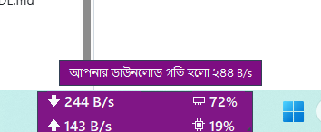

# Bangla Net Speed Meter (বাংলা নেট স্পিড মিটার)

A clean, ultra-lightweight, and always-on-top network speed meter for **Windows 11 and Windows 10**. It sits unobtrusively on or near your taskbar and shows live download (↓) and upload (↑) speeds, plus optional CPU and RAM usage — with **pure Bengali (বাংলা)** language support, zero telemetry, no admin rights, and minimal memory footprint (<30 MB RAM).

Developed by [Iqbal Mahmud](https://iqbalmahmud.com) · Current version: **[v1.3.0](https://github.com/iqbalmbadhan/BanglaNetSpeed/releases/latest)** · [Changelog](CHANGELOG.md)

---

## 🚀 Direct Downloads

| Package Type | Download Link | Description |
| :--- | :--- | :--- |
| **Setup Installer (Recommended)** | ⬇️ **[BanglaNetSpeed-Setup.exe](https://github.com/iqbalmbadhan/BanglaNetSpeed/releases/latest/download/BanglaNetSpeed-Setup.exe)** | Standard Windows Setup wizard with Start Menu, Desktop shortcuts, and clean uninstaller in Windows Settings. |
| **Portable Standalone EXE** | 📦 **[BanglaNetSpeed.exe](https://github.com/iqbalmbadhan/BanglaNetSpeed/releases/latest/download/BanglaNetSpeed.exe)** | Single-file portable executable. Runs immediately anywhere without installation. |
| **All Releases & Hashes** | 🔗 **[GitHub Releases Page](https://github.com/iqbalmbadhan/BanglaNetSpeed/releases)** | View all release builds, release notes, and SHA-256 verification checksums. |

---

## 📸 Screenshots

### 🇧🇩 Pure Bengali (বাংলা) Mode & Live Hover Tooltips
Hover over any speed bar or hardware metric for dynamic live status (e.g. *"আপনার আপলোড গতি হলো ১২৩.৪৭ KB/s"*):

<p align="center">
  
</p>

### 🖥️ Docked on Windows 11 Taskbar
<p align="center">
  
</p>

| Default Dark Theme | Custom Colors & Themes |
| :--- | :--- |
|  |  |

---

## ✨ Features

- 🇧🇩 **Pure Bengali (বাংলা) Interface:** Complete Bengali language switcher right from the right-click menu (**Language / ভাষা**). All menus, dialogs, units, and tooltips switch seamlessly.
- 💬 **Interactive Hover Tooltips:** Hover over Upload, Download, RAM, or CPU to see full live status text:
  - English: *"Your upload speed is 12 MB/s"*, *"RAM usage is 68%"*
  - বাংলা: *"আপনার আপলোড গতি হলো ১২ MB/s"*, *"র‍্যাম ব্যবহার হলো ৬৮%"*
- 📊 **Flexible Speed Layouts:**
  - **Horizontal:** Classic single-line speeds side by side (`↓ ...  ↑ ...`).
  - **Stacked (2 rows):** Upload on top or Download on top, matching the RAM/CPU column height for an ultra-compact footprint.
- ⚡ **Ultra-Lightweight & Efficient:** Consumes sub-30 MB RAM and near-zero CPU. Written in native Python & Tkinter without heavy web wrappers (no Electron or Chromium bloat).
- 🧠 **Live CPU & RAM Usage:** Optional hardware percentage monitor (both stacked, RAM only, CPU only, or hidden).
- 📏 **Auto-scaling Units:** Auto Bytes (B/s → GB/s), Auto Bits (bps → Gbps), or fixed MB/s, Mbps, KB/s, Kbps.
- 🌐 **Interface Selection:** Monitor all network interfaces combined or pin to a specific adapter (Wi-Fi, Ethernet).
- 🎨 **Deep Customization:** Custom font colors, font weight (Normal, Semi-bold, Bold), font sizes (8–12 pt), and background color.
- 🖱️ **Drag & Resize:** Left-click drag to position anywhere on the screen. Resize using the bottom-right corner grip (`◢`), right-click menu, or **Ctrl + Mouse Wheel**.
- 📌 **Always on Top:** Stays visible above the taskbar and full-screen windows with automatic topmost recovery.
- 🔔 **System Tray Integration:** Minimize, bring to front, or exit directly from the Windows notification area tray icon.
- 🚀 **Start with Windows:** Optional startup entry for the current user account without requiring administrator privileges.
- 🔒 **Zero Telemetry & 100% Privacy:** No tracking, no analytics, no external network requests. Verified SHA-256 release builds.

---

## 💻 Requirements

- **Operating System:** Windows 11 or Windows 10 (64-bit)
- **Using the Installer or EXE:** No external dependencies required! Everything is self-contained.
- **Running from source (Developers):** Python 3.10+ (CI builds with 3.12).

---

## 📦 Installation Options

### Option 1: Classic Setup Installer (Recommended)
1. Download **`BanglaNetSpeed-Setup.exe`** from [Latest Release](https://github.com/iqbalmbadhan/BanglaNetSpeed/releases/latest).
2. Run the setup wizard to install into `%LOCALAPPDATA%\Programs\BanglaNetSpeed\`.
3. Choose whether to create a Desktop shortcut and auto-start on Windows boot.
4. Cleanly uninstalls anytime from **Windows Settings → Installed Apps**.

### Option 2: Portable Standalone Executable
1. Download **`BanglaNetSpeed.exe`** from [Latest Release](https://github.com/iqbalmbadhan/BanglaNetSpeed/releases/latest).
2. Place it in any folder and double-click to launch.

### Option 3: Run from Source
```powershell
# 1. Clone repository
git clone https://github.com/iqbalmbadhan/BanglaNetSpeed.git
cd BanglaNetSpeed

# 2. Setup virtual environment and run
install_and_run.bat

# On subsequent runs
run_widget.bat
```

---

## ⚙️ Right-Click Menu Options

Right-click anywhere on the widget to open settings:

| English Menu | বাংলা মেনু | Function |
| :--- | :--- | :--- |
| **Speed unit** | গতির একক | Auto bytes, Auto bits, MB/s, Mbps, KB/s, or Kbps |
| **Speed layout** | গতির বিন্যাস | Horizontal, Stacked (Upload top), or Stacked (Download top) |
| **Language / ভাষা** | ভাষা (Language) | Switch between English and pure Bengali (বাংলা) |
| **Network interface** | নেটওয়ার্ক ইন্টারফেস | All interfaces combined, or choose a specific adapter |
| **Font color** | ফন্টের রঙ | Preset colors (White, Black, Blue, Green, Purple, Orange) or Custom |
| **Font weight** | ফন্ট পুরুত্ব | Normal, Semi-bold, or Bold |
| **Font size** | ফন্টের আকার | 8 pt to 12 pt |
| **CPU / RAM usage** | সিপিইউ / র‍্যাম ব্যবহার | CPU + RAM, RAM only, CPU only, or Hidden |
| **Widget size** | উইজেটের আকার | Wider, Narrower, Taller, Shorter, or Reset size |
| **Background color…** | ব্যাকগ্রাউন্ড রঙ… | Pick any color for the widget background |
| **Reset position** | টাস্কবারে অবস্থান রিসেট | Snaps the widget back to the taskbar notification tray |
| **Start with Windows** | উইন্ডোজের সাথে চালু করুন | Enable or disable auto-start on Windows boot |
| **Open website** | ওয়েবসাইট দেখুন | Opens the developer's website ([iqbalmahmud.com](https://iqbalmahmud.com)) |
| **Exit** | প্রস্থান | Closes the widget and removes the tray icon |

---

## 🔒 Security & Verifying Downloads

Release binaries are built via automated GitHub Actions with full provenance attestations. To verify your downloaded file against the published SHA-256 checksum:

```powershell
Get-FileHash .\BanglaNetSpeed-Setup.exe -Algorithm SHA256
```

Compare the output hash with the `.sha256.txt` file attached to the [GitHub Release](https://github.com/iqbalmbadhan/BanglaNetSpeed/releases).

---

## 👨‍💻 Developer & License

Developed with ❤️ by **[Iqbal Mahmud](https://iqbalmahmud.com)**.

Distributed under the **[MIT License](LICENSE)**. Free and open source for personal and commercial use.
